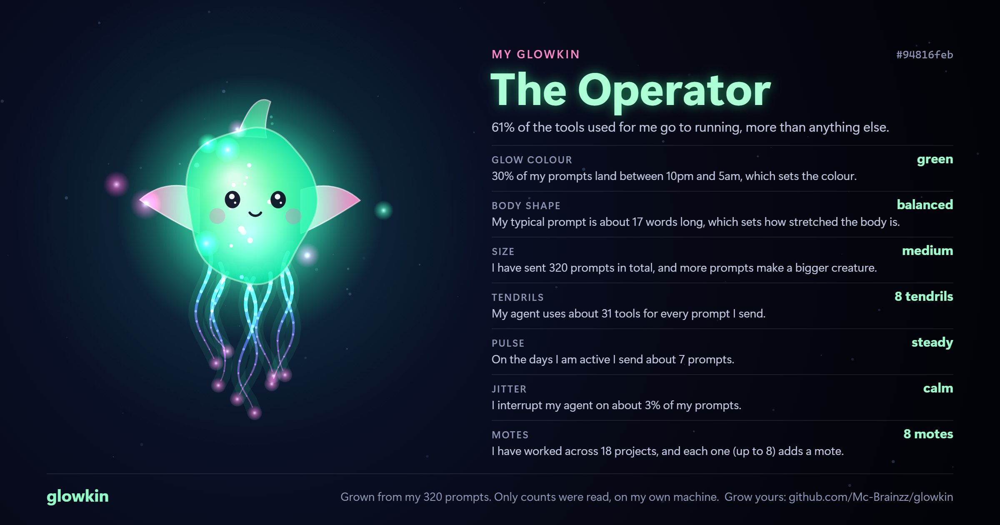
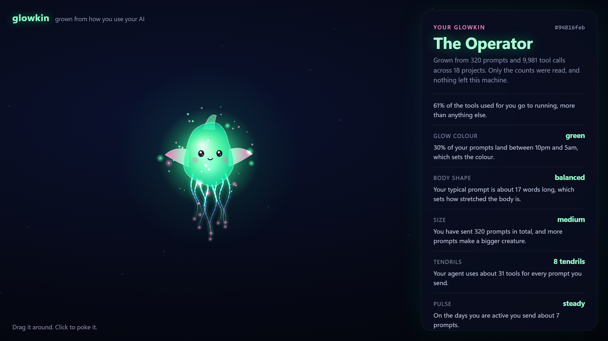

# glowkin

**A glowing creature grown from how you use your AI.**

**[Try it in your browser](https://mc-brainzz.github.io/glowkin/)**: you will meet a random stranger. Grow your own below.



glowkin reads your AI coding history on your own machine, turns it into a handful of numbers, and grows a creature from them. Night owls glow violet. People whose agents run a lot of tools get more tendrils. No two come out the same.

You can meet it in the browser, save a card to share, and let it float on your desktop where you can drag it around.

## Grow yours

You need [Node.js](https://nodejs.org) 20 or newer and some [Claude Code](https://claude.com/claude-code) history.

```bash
git clone https://github.com/Mc-Brainzz/glowkin
cd glowkin
npm run hatch
npm start
```

Then open http://localhost:4173. Drag your creature around, click it to poke it, press **Save card** to get an image like the one above, or press **Meet a stranger** to see what other habits would have grown.

No history yet? Skip `npm run hatch` and you will get a stranger to play with.



## What shapes it

Every part of the creature comes from one number, and the page tells you which.

| Part | Comes from |
|---|---|
| Glow colour | How many of your prompts land between 10pm and 5am. Amber for daytime, through green and blue, to violet for night owls. |
| Body shape | The length of your typical prompt. Short prompts make a compact body, long ones a tall one. |
| Size | How many prompts you have sent. |
| Tendrils | How many tools your agent uses per prompt (2 to 8 tendrils). |
| Tendril length | How long your sessions usually run. |
| Pulse | How many prompts you send on an active day. |
| Jitter | How often you interrupt your agent. |
| Motes | How many projects you have worked in (up to 8). |
| Eyes | How often you ask questions. |

The tools your agent uses most decide what kind of creature it is:

| Archetype | You mostly... | It grows |
|---|---|---|
| Builder | write and edit files | crystal shards |
| Explorer | read and search code | lantern antennae |
| Operator | run commands | fins |
| Researcher | search and browse the web | a halo |
| Conductor | hand work to other agents | a crown of lights and a ring of motes |
| Wanderer | have not used tools yet | a single wisp |

The exact formulas are in [docs/genome-spec.md](docs/genome-spec.md).

## Privacy

This is the part to check before you run anything that reads your history, so here is exactly what happens.

- **What is read:** the session logs in `~/.claude/projects`, on your machine.
- **What is kept:** counts and ratios only. How many prompts, what hour they were sent, how many words, which tools were called. The text of your prompts, your file names and your project names are never stored or written anywhere.
- **What is written:** one file, `genome.json`, plus a copy in `~/.glowkin` for the desktop overlay. Open it and look. It is a few dozen numbers.
- **What is sent:** nothing. There are no network calls and no dependencies in the analyzer.

The whole analyzer is four short files in [src/](src), about 300 lines. `genome.json` is in `.gitignore` so you do not publish your numbers by accident.

## Put it on your desktop

The overlay is a small transparent window that stays on top of everything. Drag the creature anywhere, click it to poke it, and its eyes follow your cursor. Clicks pass straight through the empty space around it.

You need [Rust](https://rustup.rs) (a recent stable version) as well as Node.

```bash
npm install
npm run overlay:build
```

Then run `src-tauri/target/release/glowkin` (`glowkin.exe` on Windows). To close it, right-click its icon in the system tray and choose **Quit glowkin**.

It reads `genome.json` from the folder you start it in, then from `~/.glowkin`. Set `GLOWKIN_GENOME` to point it at any other genome file.

## Customise it with your AI

The creature is just `genome.json` plus one renderer file, so your own AI agent can change it. Open this folder in your agent and try:

> Read docs/genome-spec.md and web/creature.js. Then edit genome.json so my glowkin is violet, calmer, and has three long tendrils.

> Add a new archetype called "gardener" for people who mostly write tests. Give it leaves instead of fins.

> Make the eyes sleepy after midnight.

Running `npm run hatch` again rebuilds `genome.json` from your history and replaces hand edits, so keep a copy of a genome you like.

## Status

This is an early version. Here is what is and is not there yet.

- **History:** Claude Code only. Other agents need an adapter (see below).
- **Overlay:** built and tested on Windows 11 only. It is written with [Tauri](https://tauri.app), which also targets macOS and Linux, but nobody has tried it there yet.
- **Downloads:** there are no prebuilt apps. You build the overlay yourself for now.
- **Cost:** on the one machine it was measured on, the idle overlay used between 3% and 21% of one CPU core and 100 to 170 MB of memory.

## Contributing

The most useful things to add:

- **An adapter for another agent** (Codex, Cursor, Gemini CLI, a ChatGPT export). An adapter is one file in [src/adapters/](src/adapters) that turns that tool's logs into three kinds of event: `prompt`, `tool` and `interrupt`. The shapes are in section 1 of the [spec](docs/genome-spec.md), and [claude-code.mjs](src/adapters/claude-code.mjs) is the example to copy.
- **A report from macOS or Linux** on whether the overlay builds and behaves.
- **New archetypes and body parts** in [web/creature.js](web/creature.js).

Run the tests with `npm test`. Two rules hold everywhere: nothing but counts leaves the adapter, and the analyzer stays free of dependencies.

## Licence

[MIT](LICENSE)
